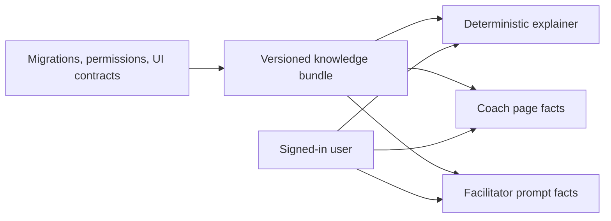
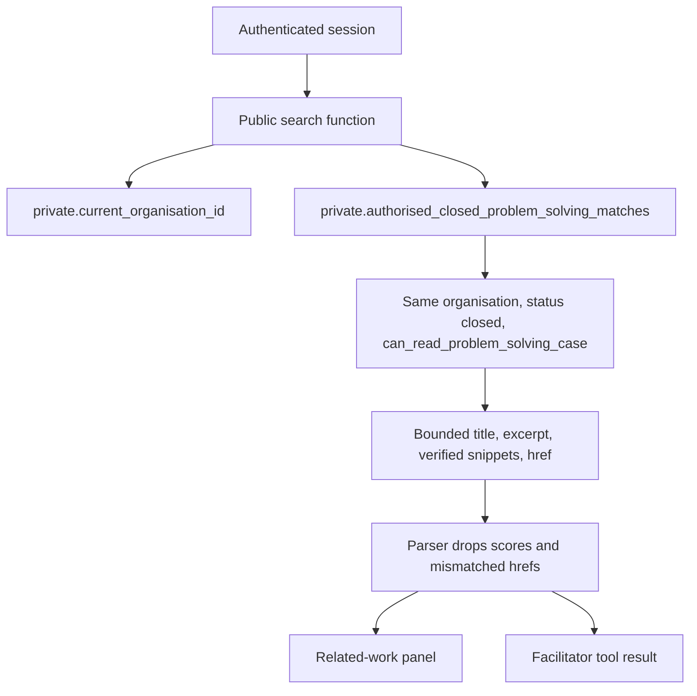
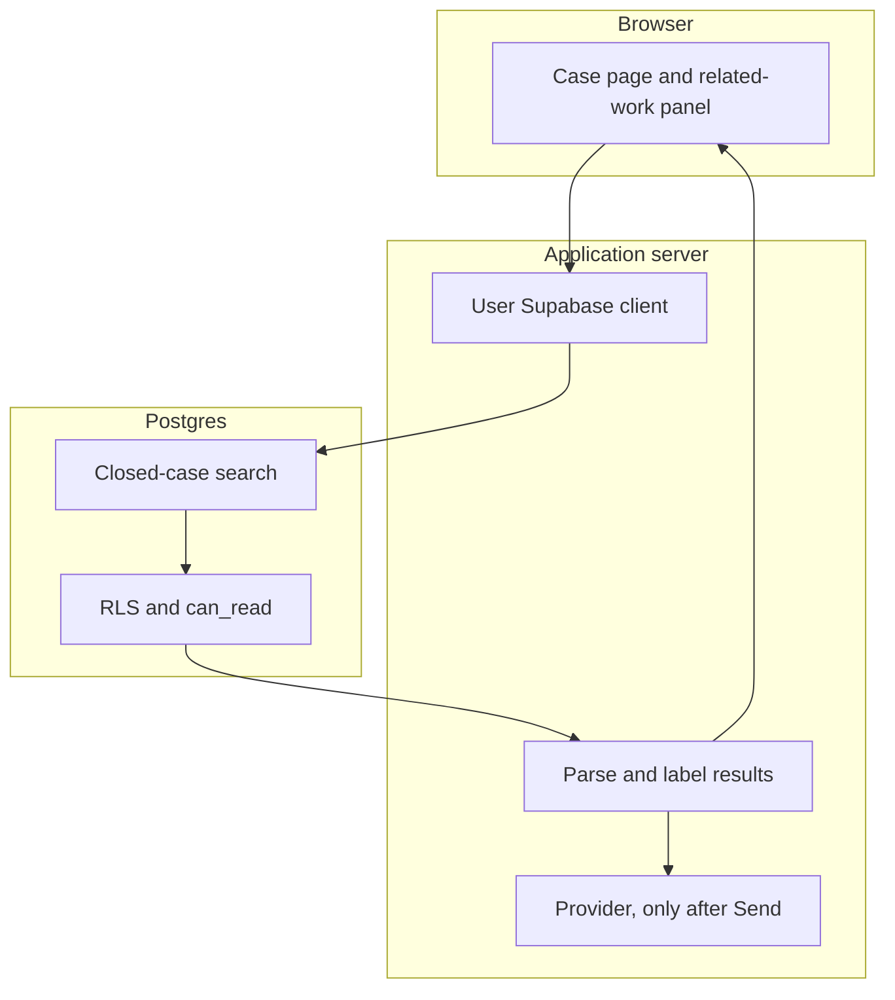

# LeanAI superpowers

Programme: LEANAI-SUPERPOWERS-001

This document records the audited capability matrix and the security boundary for LeanAI as the intelligence layer of Lean Excellence Hub. It does not claim that the long-term programme is shipped.

The first implementation slice is source-backed Problem Solving knowledge plus permission-checked historical case retrieval. Suggestions, Actions, and cross-module search stay backlog.

## Identity

LeanAI remains one assistant.

| Surface | Session | Orchestrator | Writes |
| --- | --- | --- | --- |
| Workspace Coach | `ai_sessions.context_type = coach`, `create_ai_coach_session` | `runCoachAiTurn` | No proposals. Navigation and explanation only. |
| Module setup builders | Coach session, intervention `setup_builder` or `maturity_framework_builder` | Dedicated builder orchestrators | Editable draft after a person accepts. No publish. |
| Problem Solving facilitator | `ai_sessions.context_type = problem_solving`, bound to one case | `runAiTurn` | Typed proposals. A person accepts them through existing case RPCs. |

Coach conversations and the facilitator do not share a session row. They share the LeanAI name, the provider registry, `start_ai_run` / `finish_ai_run`, and usage accounting.

Opening a page, changing route, and calculating setup readiness do not call a model. Historical search does not call a model. The facilitator calls a model only after the person sends a message.

## Capability matrix

Status is based on code, migrations, and tests on `main` at the start of this programme, plus the first slice. A button or a prompt line is not enough to mark a capability complete.

| Capability | Status | Evidence |
| --- | --- | --- |
| Server-side orchestrator, provider abstraction, usage accounting | IMPLEMENTED | `src/platform/ai/orchestrator.ts`, `coach-orchestrator.ts`, `start_ai_run`, `finish_ai_run` |
| Coach sessions separate from facilitator sessions | IMPLEMENTED | ADR-0018, `create_ai_coach_session` |
| Facilitator modes Facilitate, Challenge, Review, Ask | IMPLEMENTED | Session mode plus prompt v4. The mode is stored when the session is created. |
| Facilitator read tools on the session case | IMPLEMENTED | Thirteen read tools. The turn now refuses a browser case id that does not match the session. |
| Typed proposals and human acceptance | IMPLEMENTED | Forbidden types include verify root cause, close case, approve benefit, validate saving, assign RBAC. |
| Skills field-level product knowledge | IMPLEMENTED | Versioned bundle. Coverage `complete` only when field gaps are empty. |
| Problem Solving field-level product knowledge | IMPLEMENTED in this slice | `product-knowledge/problem-solving.ts`. Audited case fields, seeded methods, permissions, closure. |
| Deterministic Problem Solving answers when the model is off | IMPLEMENTED in this slice | `explainProblemSolvingQuestion` and the related-work panel. No provider call. |
| Product knowledge for Maturity, Suggestions, Actions, Training | IMPLEMENTED first wave | Versioned bundles in `product-knowledge/` with CI gap checks (`verify:product-knowledge`). |
| Product knowledge for People, 5S, Gemba, Recognition, Projects, Benefits, Billing | PARTIAL | Smaller audited field slices; deeper editor coverage backlog. |
| Three-path setup for Maturity, 5S, Gemba, Skills | IMPLEMENTED | Manual, LEH Quick Start, Build with LeanAI. Draft until a person publishes. |
| Three-path setup for Problem Solving methods | PLANNED, not applicable yet | Methods are seeded. There is no method-authoring screen. Manual case creation remains. |
| Setup readiness and interventions | IMPLEMENTED | Zero-token. Problem Solving is not a readiness key. |
| Permission-aware closed-case lexical search | IMPLEMENTED | `search_similar_problem_solving_cases`, extended by `search_authorised_problem_solving_history`. |
| Semantic / pgvector search | PLANNED | Not in this release. Milestone scope excluded it. Do not add a global vector store. |
| Related-work panel before a new case is saved | IMPLEMENTED for Problem Solving | Explicit search. Does not block the new case. |
| Suggestions and Actions duplicate search | IMPLEMENTED | Create-form related search (#364). Not the cross-module facade. |
| Cross-module operational knowledge search | IMPLEMENTED | `search_authorised_operational_knowledge`, LeanAI read tools. Lexical only; pgvector deferred. |
| Organisational learning graph and proactive advice | PLANNED | Design only. Out of this pull request. |
| Cross-customer benchmarks | BLOCKED BY SECURITY | Requires a separate privacy design and consent. Out of scope. |
| Autonomous domain writes by the model | BLOCKED BY SECURITY | Not allowed. Drafts stay human-accepted. |
| Runtime GitHub or hosted Supabase access for answers | BLOCKED BY SECURITY | Knowledge ships in the application. No GitHub token. |

## Product knowledge

`LEH_PRODUCT_KNOWLEDGE_VERSION` is the release the running application was built with. LeanAI does not read an arbitrary Git branch at runtime.

Each Problem Solving article carries a knowledge id, module, workflow, source path, release version, validation date, and coverage status. Field articles add the field identifier.

`PLATFORM_KNOWLEDGE_COVERAGE` marks a module complete only when `*KnowledgeFieldGaps()` is empty. Release `LEH_PRODUCT_KNOWLEDGE_VERSION` bumps with each knowledge slice. `npm run verify:product-knowledge` fails CI when audited identifiers are missing from articles.

A unit test reads the permission registry, the latest closure-outcome constraint, and the seeded method codes. A code change that drops those contracts out of the knowledge bundle fails the test.

End-user answers point at `/platform/problem-solving` and `/platform/problem-solving/new`. They do not depend on a GitHub link.

### What this release can say

- A case needs a title, an organisation unit, and an owner. Activation chooses a published method.
- Seeded methods are A3 / 8-step (`a3_structured`), Rapid root cause analysis (`rapid_rca`), and 5 Why (`five_why`).
- DMAIC and 8D are not problem-solving method records. A CookieWorks project seed is not a customer-wide method.
- Hypothesis statuses are proposed, testing, supported, verified, rejected, and superseded.
- Closure outcomes are `resolved_verified_cause`, `resolved_without_verified_cause`, and `transferred`.
- Permissions are view, create, contribute, manage, facilitate, verify_cause, and close.
- `ai.use` does not grant case access.

## Retrieval

`search_authorised_problem_solving_history(query, limit)` searches before a case exists.

`search_similar_problem_solving_cases(case_id, limit)` keeps the existing entry point. It reads the case text on the server and calls the same helper.

Rules:

- The browser cannot supply an organisation id, role, or permission flag.
- The helper turns the text into English lexemes. The query is not SQL.
- A query of three or fewer content words must match all of them. A longer query matches a closed case when at least three of those content words appear in its title or problem statement. One or two shared words do not match. A relevant case that shares fewer than three words, or describes the same event in different words, can still be missed. The result is empty. It is not a hint that hidden cases exist.
- Only `closed` cases are candidates. Draft, active, and cancelled cases are omitted.
- Each candidate passes `private.can_read_problem_solving_case` before its title, excerpt, or verified snippets are returned. The functions are `SECURITY DEFINER` and stay owned by the migration role, which bypasses `FORCE RLS`. They are not reassigned to `lean_hub_private_owner`. The function body is the authorisation boundary.
- Verified snippets are hypotheses with `status = verified` on that same readable case. That is the same case predicate as `problem_solving_hypotheses_select`. Proposed, testing, supported, rejected, and superseded statements are not returned.
- Verified snippets are limited to three statements of 240 characters.
- The payload has no numeric rank and no hidden-match count.
- A verified cause is labelled `historical_verified_outcome`. It is evidence about that case, not proof for the new problem.
- Empty or stop-word queries return `[]`.
- Missing organisation context and an unreadable source case raise `42501` with a fixed message.
- `anon` and `service_role` cannot execute the public history function. `authenticated` cannot execute the private helper.

pgvector is not used. The existing GIN index on title and problem statement remains the index.

## Case journey

On `/platform/problem-solving/new`, Find related work searches the draft title and problem statement. The person can open a match, wait until the draft exists before linking, or continue. The create action stays available.

On an existing case, Find related work calls the similar-case function for that case id. Contribute or link calls the existing source-link RPC, which checks that the source can be referenced. The model is not involved.

The facilitator tool `search_related_problem_solving_cases` uses the same similar-case function. The result is parsed before it reaches the model. Citations are allowlisted from those ids only.

Before a facilitator turn, the server reads `ai_sessions.problem_solving_case_id` for the session. If it differs from the case id on the request, the turn stops before `start_ai_run` and before any tool call.

## Security boundary

Tenant, site, and record filters run in SQL before text is returned. The model never receives candidates the user cannot read.

Same organisation does not mean same site. A unit-subtree `problem_solving.view` grant returns cases in that subtree only. A parent the user can read does not reveal an unreadable case on another site.

Search does not report that hidden rows exist. Counts and scores are not returned.

Organisation context is stored per auth session and user. A facilitator turn will not read a case other than the session case.

Cache is not added for search results. Stored AI sessions stay on the existing organisation and membership policies.

Record text is untrusted. The prompt and the deterministic consultation refuse instructions embedded in a description, including requests to change organisation.

Ordinary retrieval does not use the service role.

`FORCE RLS` on problem-solving tables is unchanged. The search functions are `SECURITY DEFINER` with `search_path = ''`, matching the previous similar-case function, because they must apply `can_read` and then read verified hypotheses for cases the caller can read. They are not granted to `anon` or `service_role`.

## Source classes

Answers are labelled in the deterministic consultation:

| Class | Meaning |
| --- | --- |
| Verified LEH product fact | Release knowledge bundle |
| Current authorised site fact | A record returned by an authorised read |
| Historical verified outcome | A verified cause on a closed case the user can read |
| Unverified user statement | Text the person typed, including a suspected cause |
| Lean methodology recommendation | A method suggestion, not a finding |
| AI hypothesis | A model proposal, still a draft until a person accepts it |

If the bundle does not support a question, the explainer says so. DMAIC, 8D, and vector search are explicit gaps.

## What the model must not do

The facilitator must not verify a root cause, close a case, record an effectiveness pass, approve a financial benefit, assign permissions, or declare equipment safe. Those actions stay on the existing human RPCs. Prompt v4 states that. The database still rejects forbidden proposal types on `finish_ai_run`.

## Rollout

1. Apply the migration on the target database before the application that calls `search_authorised_problem_solving_history`.
2. Deploy the application. No new environment variable is required.
3. Confirm a member who can read closed cases can search, and a member scoped to one site cannot see another site's title.
4. Confirm case creation still works with LeanAI disabled.

Do not apply the migration to hosted Supabase without owner approval. Do not deploy to Netlify from this change. Do not reset customer data.

See `docs/operations/leanai-superpowers-runbook.md`.

## Remaining programme

Tracked as GitHub issues, not as code in this pull request:

- Suggestions and Actions similarity before save.
- Field-level knowledge for the modules still marked partial or not started.
- A cross-module search that calls each family's existing read predicate.
- Organisational learning across Suggestion, Action, Project, Benefit, Gemba, 5S, and Maturity.
- Any future embedding index, only after a separate security design. Not a global vector store.
